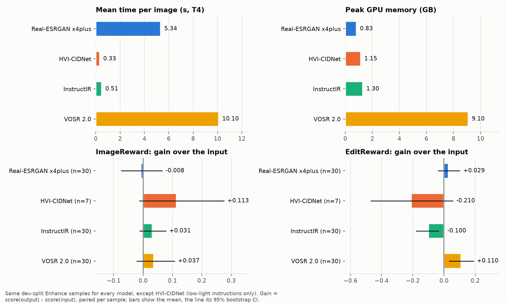

# Enhance benchmark report (MODEL_LIST.md, list 4)

Run on 2026-11-22 on Kaggle (1 x T4 used; fp16/fp32 as listed below). Four models, 30 dev-split samples of the
category Enhance (any subject), fixed hash order, seed 0, inputs shrunk to a long side of 1024 px (never enlarged).
Nothing here is a human judgement: the scores come from two reward models that were not trained on Enhance
preferences, so read them as a first signal, not a ranking.

## Scope and what changed from MODEL_LIST.md

- **AceTone is out.** The only released checkpoint (`Vivre/AceTone-3B-PST-Preview`, PST = photo style transfer)
  takes the raw photo **and a reference photo**, not an instruction (`demo/predict_lut.py`,
  `eval/predict_lut_ddp.py`); the repository has no text-conditioned inference, and our samples have no reference
  photo (a human edit as reference would leak the answer). It moved to "Left out" in MODEL_LIST.md. The bf16 to fp16
  and flash-attention-2 to `sdpa` patches were therefore never needed.
- **Samples:** 30 per model, except HVI-CIDNet, which by rule runs only on low-light instructions: 7 of the 30 ran, 23
  were recorded as `skipped`. The "low-light" test is a keyword match on the instruction; 3 of the 7 matches do not
  ask for more light ("Add a creepy/dark effect", "very blurry and slightly darker", "Blend the lighting to make the
  image look real"), and HVI-CIDNet brightened them anyway. Its numbers are on n = 7 and should not be over-read.
- **Output size:** every output is the size of the (shrunk) input. Real-ESRGAN's x4 output is shrunk back with
  LANCZOS; VOSR runs with `-u 1`. So the models are compared at equal resolution.
- Inputs: `{"dataset": "cryandrrich/editjudge", "split": "dev", "category": "Enhance*"}`; list in
  `work/editors/full/samples.json` (git-ignored).

## Results

| Model | ok / failed / skipped | black / non-finite | s per image | first image (s) | load (s) | peak GPU (GB) | ImageReward gain [95% CI], win rate | EditReward gain [95% CI], win rate |
|---|---|---|---|---|---|---|---|---|
| Real-ESRGAN x4plus | 30 / 0 / 0 | 0 / 0 | 5.34 | 15.4 | 9 | 0.83 | -0.008 [-0.074, +0.065], 50% (n=30) | +0.029 [-0.038, +0.101], 53% (n=30) |
| HVI-CIDNet | 7 / 0 / 23 | 0 / 0 | 0.33 | 1.8 | 5 | 1.15 | +0.113 [-0.012, +0.275], 86% (n=7) | -0.210 [-0.469, +0.057], 14% (n=7) |
| InstructIR | 30 / 0 / 0 | 0 / 0 | 0.51 | 1.4 | 37 | 1.30 | +0.031 [-0.011, +0.078], 67% (n=30) | -0.100 [-0.177, -0.036], 23% (n=30) |
| VOSR 2.0 | 30 / 0 / 0 | 0 / 0 | 10.10 | 25.7 | 87 | 9.10 | +0.037 [-0.021, +0.107], 60% (n=30) | +0.110 [+0.035, +0.189], 77% (n=30) |

Time is the mean per image **without the first image** (cuDNN warm-up and tile set-up); the first image and the model
load time are listed separately. Peak GPU memory is the largest `torch.cuda.max_memory_allocated` over the images
(weights included). Gain = reward(output) minus reward(unedited input), paired per sample, with a 95% bootstrap
interval (4,000 draws) and the share of samples where the output scored higher.

## Reading the results

- **Reliability:** all four models ran without a failed sample, a black or non-finite image, or an out-of-memory error.
  Nothing came near the 15 GB of one T4: VOSR 2.0 is the heaviest at 9.1 GB, the others stay near 1 GB.
- **Cost:** InstructIR (0.5 s) and HVI-CIDNet (0.3 s) are fast; Real-ESRGAN takes 5.3 s because of the x4 pass on
  tiles; VOSR 2.0 takes 10.1 s with 87 s of load time.
- **Quality, by the reward models:**
  - Only two gains have an interval that excludes zero: **VOSR 2.0 on EditReward (+0.110, higher on 77% of samples)**
    and **InstructIR on EditReward (-0.100, higher on 23%)**. Everything else is within noise at n = 30 (or 7).
  - The two reward models disagree on InstructIR and HVI-CIDNet (ImageReward up, EditReward down). ImageReward is a
    text-to-image model: it reads the instruction and the output, never the input, so it cannot tell a faithful
    enhancement from a different picture. EditReward sees all three, so we trust it more for edits, but it has not
    been checked against human rankings on Enhance.
  - Real-ESRGAN is statistically the same as doing nothing on both scores. That is expected: most samples are not
    degraded in the way it was trained for, and the output is shrunk back to the input size.
  - Looking at the images (local grids): HVI-CIDNet brightens strongly and adds a blue/magenta cast; InstructIR and
    Real-ESRGAN change little; VOSR 2.0 sharpens detail while keeping colours. This matches the score pattern.
- **Open question for the full ranking:** the shared generalist models (list 1) decide Enhance Person and most vague
  requests ("Make me look beautiful"); none of the four here is meant for those, so this benchmark cannot say which
  model should win the Enhance task overall.

## Limits

- 30 samples (7 for HVI-CIDNet), one seed, no repeated runs: intervals are wide.
- Reward models only; no human check. ImageReward ignores the input image. The unedited input is itself scored as
  a "do nothing" baseline in every comparison.
- Keyword low-light filter, as above.
- Default settings from the model cards (see `notebook_runner.py`): HVI-CIDNet alpha_s = alpha_i = gamma = 1;
  InstructIR takes the raw instruction as its prompt; VOSR 2.0 one step, tile 512, wavelet colour fix.
- Timing is on one Kaggle T4 with other work possible on the host; compare ratios, not absolute seconds.

## Files

| What | Where |
|---|---|
| Runner (Kaggle script) | `notebook_runner.py`, `kernel-metadata.json` (kernel `stevenpaulli/enhance-models-benchmark`, version 3) |
| Scoring (Kaggle script) | `scoring/score_runner.py` (kernel `stevenpaulli/enhance-models-scoring`) |
| Charts, table, grids | `scripts/visualize_enhance.py`; `reports/enhance/comparison.png`, `stats.json`, `stats.md` |
| Outputs, `runs.jsonl`, scores, grids | `work/editors/full/` (git-ignored; photos of people, never publish) |
| Smoke run | `work/editors/smoke/`, summarised in `PROGRESS.md` |
