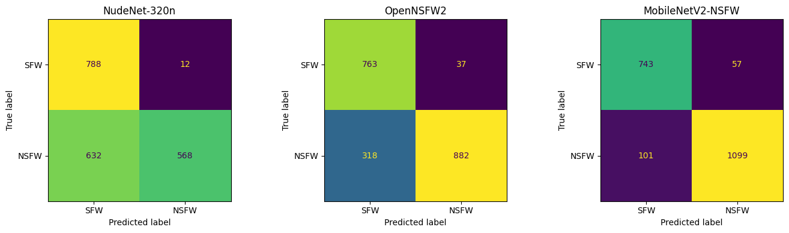
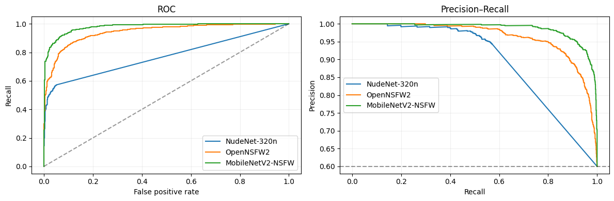

# So sánh ba model lọc ảnh NSFW

[Nude.ipynb](Nude.ipynb) chứa code và output của lần chạy hoàn tất trên Kaggle.
Trên 2.000 ảnh được đánh giá, **MobileNetV2 NSFW có F1 cao nhất (0,9329) và thời gian
xử lý trung bình thấp nhất (8,288 ms/ảnh)** trong ba cách triển khai được thử.

## Kết quả

Ngưỡng quyết định cố định là **0,5** cho cả ba model.

| Model | Accuracy | Precision | Recall | F1 | ROC-AUC | Average Precision |
| --- | ---: | ---: | ---: | ---: | ---: | ---: |
| NudeNet-320n | 0,6780 | 0,9793 | 0,4733 | 0,6382 | 0,7703 | 0,8221 |
| OpenNSFW2 | 0,8225 | 0,9597 | 0,7350 | 0,8325 | 0,9428 | 0,9632 |
| MobileNetV2-NSFW | 0,9210 | 0,9507 | 0,9158 | 0,9329 | 0,9790 | 0,9859 |

| Model | Trung bình (ms/ảnh) | p50 (ms/ảnh) | p95 (ms/ảnh) | Ảnh/giây | Tổng thời gian đo (s) |
| --- | ---: | ---: | ---: | ---: | ---: |
| NudeNet-320n | 17,316 | 17,178 | 18,977 | 57,751 | 34,632 |
| OpenNSFW2 | 195,510 | 194,584 | 203,597 | 5,115 | 391,019 |
| MobileNetV2-NSFW | 8,288 | 8,255 | 9,387 | 120,651 | 16,577 |

## Dữ liệu và cách đo

- Nguồn: [deepghs/nsfw_detect](https://huggingface.co/datasets/deepghs/nsfw_detect),
  file `nsfw_dataset_v1.zip`.
- Bản dataset được tải trong notebook có 28.000 ảnh JPG, mỗi lớp 5.600 ảnh.
- Benchmark lấy 400 ảnh từ mỗi lớp `drawings`, `hentai`, `neutral`, `porn`, `sexy`.
  Sắp xếp đường dẫn trước khi lấy mẫu, dùng seed 42 và xáo trộn theo cùng code
  với notebook benchmark của nhóm. CSV có sẵn được dùng lại thay vì lấy mẫu lại.
- Nhãn dương NSFW: `porn`, `hentai`, `sexy` (1.200 ảnh). Nhãn âm SFW:
  `neutral`, `drawings` (800 ảnh).
- Cả 2.000 ảnh đều đọc được; không phát hiện bản sao có cùng SHA256 trong tập mẫu.
- Fingerprint của benchmark, gồm thứ tự ảnh, nhãn và hash nội dung:
  `261b3cca292d7cd6b31ba92ac20ad93c7336c11bb7779b2012d48a1104457f3b`.
- GPU sử dụng: **Tesla T4**, thiết bị 0. Batch size bằng **1**; warm-up 3 lần.
- Thời gian đo gồm đọc ảnh, preprocessing, inference và postprocessing.
  Cài thư viện, tải dữ liệu/trọng số, kiểm tra ảnh và warm-up nằm ngoài phép đo.
- `PR_AUC_AP` là Average Precision. Không tối ưu ngưỡng trên tập benchmark.

## Model và giới hạn diễn giải

- **NudeNet-320n**: checkpoint ONNX trong `nudenet==3.4.2`, chạy với
  `CUDAExecutionProvider`. Điểm cấp ảnh là confidence cao nhất trong các vùng
  lộ rõ được chọn: ngực nữ, bộ phận sinh dục, mông và hậu môn; không phát hiện
  thì điểm bằng 0. Đây là điểm detector sau hậu xử lý, chưa hiệu chỉnh thành
  xác suất NSFW.
- **OpenNSFW2**: trọng số Yahoo Open-NSFW, dùng preprocessing `YAHOO`, chạy bằng
  TensorFlow/Keras trên `/GPU:0`.
- **MobileNetV2 NSFW**: checkpoint GantMan release 1.2.0, MobileNetV2 1.4 / 224,
  nạp bằng `tf.saved_model.load`. RGB, nearest resize 224×224, chia 255.
  Điểm NSFW là tổng xác suất `hentai + porn + sexy`.

Benchmark hiện đo NSFW cấp ảnh. Nhãn `sexy` không đồng nghĩa với khỏa thân,
và `hentai` là ảnh vẽ. Vì thế F1/recall thấp hơn của NudeNet chưa đủ để kết luận
model kém trên bài toán nude có nhãn được rà soát riêng. Ví dụ, recall NudeNet
trên lớp `sexy` là 28,25%, còn trên `porn` là 71,00%.

Tốc độ phụ thuộc cả cách triển khai: OpenNSFW2 trong notebook gọi model Keras
theo eager execution, còn MobileNet dùng hàm SavedModel đã dựng graph. Kết quả
thời gian áp dụng cho các pipeline này trên batch 1. Cần giữ cùng cách đo và
batch size khi đối chiếu với benchmark khác hoặc khi thử tối ưu inference.

Chưa kiểm chứng tập mẫu không trùng dữ liệu pretraining của các model. Cột
`process_rss_mb_after` là RSS của toàn tiến trình sau mỗi model, không phải
bộ nhớ peak hay mức sử dụng độc lập của từng model.

## Các file kết quả

| File | Nội dung |
| --- | --- |
| [Nude.ipynb](Nude.ipynb) | Notebook đã chạy, kèm output và biểu đồ |
| [quality_metrics.csv](results_NDM/quality_metrics.csv) | Metric và TP/TN/FP/FN của ba model |
| [performance_metrics.csv](results_NDM/performance_metrics.csv) | Thời gian, throughput, thiết bị, kích thước checkpoint và số tham số có sẵn |
| [per_class_metrics.csv](results_NDM/per_class_metrics.csv) | Kết quả theo năm nhãn gốc |
| [package_versions.csv](results_NDM/package_versions.csv) | Phiên bản thư viện của lần chạy |
| [provenance.json](results_NDM/provenance.json) | Nguồn kết quả và fingerprint notebook/benchmark |

Các CSV trong thư mục `results` được trích từ **bảng output đã lưu trong notebook**:
chất lượng làm tròn 4 chữ số thập phân, hiệu năng làm tròn 3 chữ số. Chúng chưa
phải các CSV đầy đủ độ chính xác được xuất trong runtime. Dự đoán từng ảnh và
thời gian từng batch vẫn nằm trong `/kaggle/working/nude_benchmark_results/`
của phiên chạy Kaggle, chưa được đưa vào bản lưu này.

## Chạy lại trên Kaggle

1. Import `Nude.ipynb` vào Kaggle, hoặc mở bằng VS Code kết nối Jupyter kernel Kaggle.
2. Bật Internet và GPU. Tài khoản Hugging Face cần có quyền truy cập dataset;
   lưu read token trong Kaggle Secrets tên `HF_TOKEN` và cấp notebook quyền đọc.
3. Chạy các cell theo thứ tự. Nếu cell cài đặt yêu cầu restart kernel, restart
   rồi chạy lại. Giữ `USE_GPU=True`, `BATCH_SIZE=1`, seed và ngưỡng như cấu hình.
4. Lấy kết quả gốc từ `/kaggle/working/nude_benchmark_results/` và manifest mẫu
   từ `/kaggle/working/benchmark_2000.csv`. Lưu các file này trước khi kết thúc phiên.

Phiên bản chính của lần chạy: Python 3.13.15, PyTorch 2.11.0+cu128,
TensorFlow 2.20.0, Keras 3.13.2, ONNX Runtime GPU 1.23.2, OpenNSFW2 0.19.0,
NudeNet 3.4.2. Danh sách chi tiết nằm trong `package_versions.csv`.

## Nguồn model

- [NudeNet](https://github.com/notAI-tech/NudeNet)
- [OpenNSFW2](https://github.com/bhky/opennsfw2)
- [GantMan NSFW model, release 1.2.0](https://github.com/GantMan/nsfw_model/releases/tag/1.2.0)
