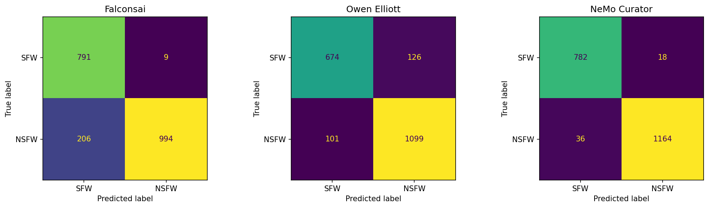
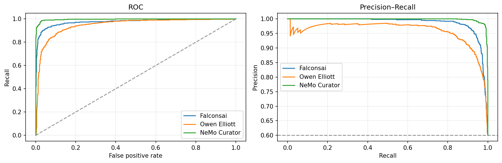

# So sánh ba model lọc ảnh NSFW

[nsfw-image-classification-v2.ipynb](nsfw-image-classification-v2.ipynb) chứa code và output của lần chạy hoàn tất trên Kaggle.
Trên 2.000 ảnh được đánh giá, **NVIDIA NeMo Curator có chất lượng tổng thể cao nhất (F1 0,9773; ROC-AUC 0,9970)**
nhưng chậm nhất (67,086 ms/ảnh). **Owen Elliott nhanh nhất (12,390 ms/ảnh)** và **Falconsai có precision cao nhất (0,9910)**
trong ba model được thử.

## Kết quả

Ngưỡng quyết định cố định là **0,5** cho cả ba model.

| Model | Accuracy | Precision | Recall | F1 | ROC-AUC | Average Precision |
| --- | ---: | ---: | ---: | ---: | ---: | ---: |
| NeMo Curator | 0,9730 | 0,9848 | 0,9700 | 0,9773 | 0,9970 | 0,9981 |
| Falconsai | 0,8925 | 0,9910 | 0,8283 | 0,9024 | 0,9757 | 0,9859 |
| Owen Elliott | 0,8865 | 0,8971 | 0,9158 | 0,9064 | 0,9494 | 0,9585 |

| Model | TN | FP | FN | TP |
| --- | ---: | ---: | ---: | ---: |
| NeMo Curator | 782 | 18 | 36 | 1.164 |
| Falconsai | 791 | 9 | 206 | 994 |
| Owen Elliott | 674 | 126 | 101 | 1.099 |

| Model | Batch size | Tổng thời gian đo (s) | Trung bình (ms/ảnh) | Ảnh/giây |
| --- | ---: | ---: | ---: | ---: |
| Owen Elliott | 32 | 24,779 | 12,390 | 80,713 |
| Falconsai | 32 | 31,120 | 15,560 | 64,267 |
| NeMo Curator | 64 | 134,172 | 67,086 | 14,906 |

## Nhận xét chính

- **NeMo Curator** dẫn đầu năm trong sáu chỉ số chất lượng (trừ precision, nơi Falconsai cao hơn: 0,9910 so với 0,9848). Model chỉ sai 54/2.000 ảnh (18 FP, 36 FN), thấp hơn hẳn Falconsai (215 ảnh) và Owen Elliott (227 ảnh). Đổi lại, thời gian xử lý lớn gấp khoảng 5,4 lần Owen Elliott và 4,3 lần Falconsai.
- **Falconsai** gần như không báo nhầm ảnh SFW (9 FP) nhưng bỏ sót 206/1.200 ảnh NSFW (recall 0,8283). Phù hợp khi ưu tiên không chặn nhầm; không phù hợp khi cần bắt đủ ảnh NSFW ở ngưỡng 0,5.
- **Owen Elliott** nghiêng về recall (0,9158) và đánh đổi bằng 126 ảnh SFW bị báo nhầm. Model này có ROC-AUC thấp nhất trong ba model (0,9494), nhưng là model nhanh nhất.
- Accuracy của Falconsai và Owen Elliott gần nhau (0,8925 và 0,8865), còn F1 gần như bằng nhau (0,9024 và 0,9064). Hai model khác nhau chủ yếu ở kiểu lỗi, không ở độ chính xác tổng thể.

## Kết quả theo lớp

Với lớp SFW (`neutral`, `drawings`), tỉ lệ dự đoán NSFW là tỉ lệ báo nhầm, càng thấp càng tốt. Với lớp NSFW (`sexy`, `hentai`, `porn`), đó là recall của lớp, càng cao càng tốt. Mỗi lớp có 400 ảnh.

| Lớp | Falconsai | Owen Elliott | NeMo Curator |
| --- | ---: | ---: | ---: |
| `neutral` (SFW) | 0,0025 | 0,0625 | 0,0150 |
| `drawings` (SFW) | 0,0200 | 0,2525 | 0,0300 |
| `sexy` (NSFW) | 0,5800 | 0,8200 | 0,9875 |
| `hentai` (NSFW) | 0,9300 | 0,9650 | 0,9225 |
| `porn` (NSFW) | 0,9750 | 0,9625 | 1,0000 |

- Lớp **`sexy`** là lớp phân hóa model rõ nhất: NeMo Curator nhận diện 98,75%, Owen Elliott 82,00%, Falconsai chỉ 58,00%. Phần lớn FN của Falconsai nằm ở lớp này.
- Lớp **`drawings`** là điểm yếu của Owen Elliott: 25,25% ảnh vẽ bị báo là NSFW, trong khi Falconsai là 2,00% và NeMo Curator là 3,00%. Phần lớn FP của Owen Elliott đến từ lớp này.
- Ở lớp **`hentai`**, NeMo Curator (92,25%) thấp hơn Owen Elliott (96,50%) và Falconsai (93,00%). Đây là lớp duy nhất mà NeMo Curator không dẫn đầu.

## Ngưỡng tối ưu F1 (tham khảo)

Ngưỡng dưới đây được chọn bằng cách tối đa hóa F1 trực tiếp trên tập benchmark, nên **không phải kết quả đánh giá độc lập** và có xu hướng lạc quan.

| Model | Ngưỡng | Precision | Recall | F1 | F1 ở ngưỡng 0,5 |
| --- | ---: | ---: | ---: | ---: | ---: |
| NeMo Curator | 0,2557 | 0,9809 | 0,9858 | 0,9834 | 0,9773 |
| Falconsai | 0,0064 | 0,9479 | 0,9408 | 0,9444 | 0,9024 |
| Owen Elliott | 0,3570 | 0,8874 | 0,9325 | 0,9094 | 0,9064 |

Falconsai hưởng lợi nhiều nhất khi hạ ngưỡng (F1 tăng từ 0,9024 lên 0,9444), cho thấy ngưỡng 0,5 mặc định chưa phù hợp với phân bố score của model này. Với Owen Elliott, F1 gần như không đổi (0,9064 so với 0,9094), nên sai số của model này không đến từ việc chọn ngưỡng.

## Dữ liệu và cách đo

- Nguồn: [deepghs/nsfw_detect](https://huggingface.co/datasets/deepghs/nsfw_detect), file `nsfw_dataset_v1.zip`, nhãn gốc gồm `drawings`, `hentai`, `neutral`, `porn`, `sexy`.
- Benchmark lấy 400 ảnh từ mỗi lớp (tổng 2.000 ảnh). Đường dẫn được sắp xếp trước khi lấy mẫu, dùng seed 42, sau đó xáo trộn toàn bộ. Cả ba model chạy trên đúng cùng danh sách ảnh (`benchmark_2000.csv`).
- Nhãn dương NSFW: `porn`, `hentai`, `sexy` (1.200 ảnh). Nhãn âm SFW: `neutral`, `drawings` (800 ảnh).
- Cả ba model đều xử lý đủ 2.000/2.000 ảnh. NeMo Curator không có score thiếu; ngưỡng lọc của stage được đặt là 1,1 để không loại ảnh nào khỏi benchmark.
- GPU: **Tesla T4**, thiết bị `cuda`. Python 3.13.15, PyTorch 2.11.0+cu128, NeMo Curator 1.3.0.
- Thời gian đo gồm đọc ảnh, preprocessing, inference và postprocessing của toàn bộ 2.000 ảnh, đo bằng `time.perf_counter()`. Cài thư viện, tải dữ liệu và tải trọng số nằm ngoài phép đo.
- `PR_AUC_AP` là Average Precision. Metric ở ngưỡng 0,5 được tính từ score NSFW của từng model.

## Model và giới hạn diễn giải

- **Falconsai** (`Falconsai/nsfw_image_detection`): model phân loại ảnh của Hugging Face Transformers, hai nhãn `normal` và `nsfw`. Điểm NSFW là xác suất softmax của nhãn `nsfw`. Chạy theo batch 32.
- **Owen Elliott** (`OwenElliott/image-safety-classifier-m`): model `timm` với ba nhãn `NSFL`, `NSFW`, `SFW`. Điểm NSFW chỉ là xác suất của nhãn `NSFW`; xác suất `NSFL` không được cộng vào. Chạy theo batch 32.
- **NVIDIA NeMo Curator** (`nemo-curator` 1.3.0): pipeline gồm embedding CLIP (`ImageEmbeddingStage`) rồi bộ chấm điểm NSFW (`ImageNSFWFilterStage`). Cần một bản vá tương thích: Transformers 5.x trả về `BaseModelOutputWithPooling` thay vì Tensor, nên notebook tự tạo embedding CLIP từ pooled features, chiếu bằng `visual_projection` rồi chuẩn hóa L2. Ảnh được đưa vào theo chunk 64; batch suy luận bên trong là 16 (embedding) và 32 (NSFW).

Các giới hạn cần lưu ý khi đọc kết quả:

- Benchmark đo NSFW **cấp ảnh** với quy ước nhị phân ở trên. Nhãn `sexy` không đồng nghĩa với khỏa thân, và `hentai` là ảnh vẽ. Vì vậy kết quả phụ thuộc nhiều vào cách mỗi model định nghĩa NSFW, đặc biệt ở hai lớp này.
- Thời gian chạy **không so sánh công bằng tuyệt đối**: batch size khác nhau (32, 32, 64) và NeMo Curator là pipeline nhiều stage, đã gồm cả bước dựng đối tượng ảnh, embedding CLIP và chấm điểm. Mỗi model chỉ chạy một lần, notebook không có bước warm-up riêng và không đo độ trễ p50/p95 từng ảnh.
- Chưa kiểm chứng tập mẫu không trùng dữ liệu huấn luyện của các model. Chưa có khoảng tin cậy; với 2.000 ảnh, chênh lệch nhỏ (ví dụ accuracy 0,8925 và 0,8865) chưa đủ để kết luận model nào tốt hơn.
- Ngưỡng 0,5 là ngưỡng mặc định, không tối ưu cho từng model. Ngưỡng tối ưu F1 ở trên chỉ mang tính tham khảo.

## Các file kết quả

Notebook ghi các file sau vào `/kaggle/working/` trong phiên chạy:

| File | Nội dung |
| --- | --- |
| `benchmark_2000.csv` | Danh sách 2.000 ảnh và nhãn gốc |
| `falconsai_predictions.csv`, `owen_predictions.csv`, `nemo_predictions.csv` | Dự đoán và score từng ảnh của mỗi model |
| `nsfw_benchmark_summary.csv` | Bảng tổng hợp metric và thời gian |
| `nsfw_benchmark_merged.csv` | Score của ba model ghép theo từng ảnh |
| `nsfw_optimal_thresholds.csv` | Ngưỡng tối ưu F1 |
| `quality_metrics.csv` | Metric và TN/FP/FN/TP của ba model |
| `per_class_metrics.csv` | Kết quả theo năm nhãn gốc |
| `performance_metrics.csv` | Thời gian đo, ms/ảnh, ảnh/giây, batch size, thiết bị |
| `confusion_matrices.png`, `roc_pr_curves.png` | Biểu đồ confusion matrix, ROC và Precision–Recall |

Các bảng trong báo cáo này được trích từ output đã lưu trong notebook (chất lượng làm tròn 4 chữ số thập phân, hiệu năng làm tròn 3 chữ số). Các file trên nằm trong phiên Kaggle, nên cần tải về trước khi kết thúc phiên nếu muốn giữ lại.

## Chạy lại trên Kaggle

1. Import `nsfw-image-classification-v2.ipynb` vào Kaggle, bật Internet và GPU.
2. Lưu Hugging Face read token trong Kaggle Secrets với tên `HF_TOKEN` và cấp quyền cho notebook.
3. Chạy các cell theo thứ tự. Cell cài NeMo Curator (`uv pip install "nemo-curator[image_cuda12]"`) có thể yêu cầu restart kernel; nếu vậy, restart rồi chạy tiếp.
4. Giữ `BATCH_SIZE=32`, `NEMO_BATCH_SIZE=64`, seed 42 và ngưỡng 0,5 để kết quả có thể đối chiếu.

## Nguồn model

- [Falconsai/nsfw_image_detection](https://huggingface.co/Falconsai/nsfw_image_detection)
- [OwenElliott/image-safety-classifier-m](https://huggingface.co/OwenElliott/image-safety-classifier-m)
- [NVIDIA NeMo Curator](https://github.com/NVIDIA-NeMo/Curator)
