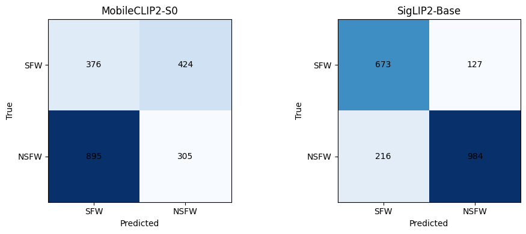
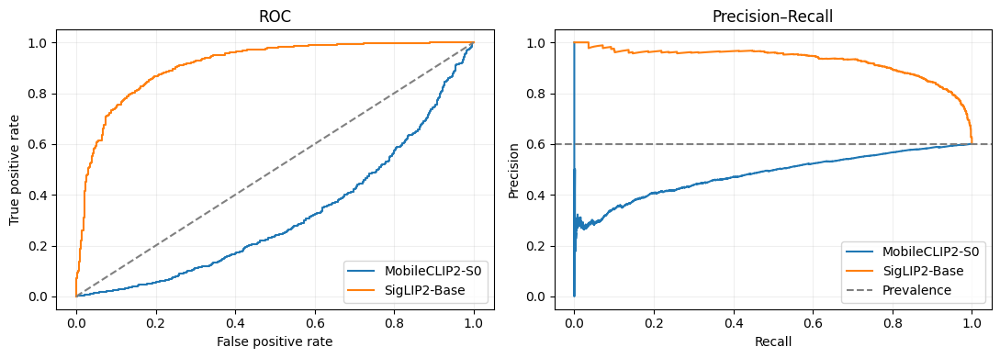

# So sánh hai model zero-shot lọc ảnh NSFW

[Nude2.ipynb](Nude2.ipynb) chứa code và output của lần chạy hoàn tất trên Kaggle,
với **MobileCLIP2-S0** và **SigLIP2 Base patch16 224**. Không fine-tune model,
không chọn prompt hoặc điều chỉnh ngưỡng theo nhãn benchmark.

Trong pipeline này, **SigLIP2 có F1 cao hơn: 0,8516**, so với 0,3162 của
MobileCLIP2-S0. MobileCLIP2-S0 nhanh hơn: 17,417 ms/ảnh so với 20,179 ms/ảnh.
Kết quả thấp của MobileCLIP2-S0, đặc biệt ROC-AUC dưới 0,5, cần được kiểm tra
thêm trước khi kết luận về năng lực model nói chung.

## Kết quả chất lượng

NSFW gồm `hentai`, `porn`, `sexy`; SFW gồm `drawings`, `neutral`.
Ngưỡng nhị phân cố định là **0,5**.

| Model | Accuracy | Precision | Recall | F1 | ROC-AUC | Average Precision |
| --- | ---: | ---: | ---: | ---: | ---: | ---: |
| MobileCLIP2-S0 | 0,3405 | 0,4184 | 0,2542 | 0,3162 | 0,3143 | 0,4810 |
| SigLIP2-Base | 0,8285 | 0,8857 | 0,8200 | 0,8516 | 0,9123 | 0,9300 |

| Model | TN | FP | FN | TP | Accuracy 5 lớp | F1 macro 5 lớp |
| --- | ---: | ---: | ---: | ---: | ---: | ---: |
| MobileCLIP2-S0 | 376 | 424 | 895 | 305 | 0,2030 | 0,1577 |
| SigLIP2-Base | 673 | 127 | 216 | 984 | 0,7550 | 0,7558 |

## Tốc độ và tài nguyên

Cả hai chạy trên **Tesla T4 / cuda:0**, batch **1**, FP32, warm-up **3 ảnh**.

| Model | Trung bình (ms/ảnh) | p50 (ms/ảnh) | p95 (ms/ảnh) | Ảnh/giây | Tổng thời gian đo (s) |
| --- | ---: | ---: | ---: | ---: | ---: |
| MobileCLIP2-S0 | 17,417 | 17,306 | 19,871 | 57,414 | 34,835 |
| SigLIP2-Base | 20,179 | 20,138 | 22,518 | 49,558 | 40,357 |

| Model | Đầu vào | Tổng tham số (triệu) | Vision encoder (triệu) | Checkpoint (MiB) | Peak GPU allocated (MiB) |
| --- | ---: | ---: | ---: | ---: | ---: |
| MobileCLIP2-S0 | 256×256 | 74,835 | 11,407 | 285,781 | 309,318 |
| SigLIP2-Base | 224×224 | 375,188 | 92,884 | 1431,275 | 1448,449 |

Số tham số MobileCLIP được đếm trước reparameterization; image backbone được
reparameterize khi suy luận. `peak_gpu_allocated_mb` đo bộ cấp phát của Torch,
không phải toàn bộ VRAM từ `nvidia-smi`. Cột `process_rss_after_mb` trong CSV là
RAM tiến trình sau chạy, không phải peak RAM độc lập của model.

Thời gian mỗi ảnh gồm đọc ảnh, tiền xử lý, image encoder, tính điểm và chuyển
kết quả về CPU, có đồng bộ CUDA. Tải checkpoint, tạo cache embedding văn bản và
warm-up nằm ngoài phép đo. Throughput là tốc độ chạy nối tiếp batch 1, chưa phải
throughput tối đa khi batching hoặc chạy đồng thời. `setup_s` gồm tải/nạp model
và chuẩn bị; riêng text cache là 0,178 s cho MobileCLIP và 0,050 s cho SigLIP2.

## Kết quả theo lớp

Với lớp NSFW, tỉ lệ dự đoán NSFW là recall; với lớp SFW, đó là tỉ lệ báo nhầm.
Mỗi lớp có **400 ảnh**.

| Lớp | Nhãn nhị phân | MobileCLIP2-S0: dự đoán NSFW | SigLIP2-Base: dự đoán NSFW |
| --- | --- | ---: | ---: |
| `drawings` | SFW | 0,6175 | 0,1725 |
| `hentai` | NSFW | 0,4475 | 0,6300 |
| `neutral` | SFW | 0,4425 | 0,1450 |
| `porn` | NSFW | 0,0600 | 0,9475 |
| `sexy` | NSFW | 0,2550 | 0,8825 |

SigLIP2 bỏ sót 216/1.200 ảnh NSFW và báo nhầm 127/800 ảnh SFW. Recall thấp nhất
trong ba lớp NSFW là `hentai` (0,6300). MobileCLIP2-S0 bỏ sót 895 ảnh NSFW,
đặc biệt chỉ phát hiện 24/400 ảnh `porn`, đồng thời báo nhầm 424 ảnh SFW.
Đây là kết quả của checkpoint, tokenizer, preprocessing và prompt trong notebook;
chưa xác định nguyên nhân của kết quả thấp. Cần kiểm tra sự tương thích của
pipeline và đánh giá trên một tập validation riêng trước khi thay đổi cấu hình.
Không đảo điểm, chỉnh prompt hoặc chọn lại ngưỡng trên benchmark này.

## Dataset và cách tính điểm zero-shot

- Dataset: [deepghs/nsfw_detect](https://huggingface.co/datasets/deepghs/nsfw_detect),
  archive `nsfw_dataset_v1.zip`, 28.000 ảnh JPG, 5.600 ảnh/lớp.
- Benchmark: 2.000 ảnh, 400/lớp; sắp xếp đường dẫn, lấy mẫu bằng `random.Random(42)`,
  sau đó xáo trộn bằng pandas với seed 42. Có 1.200 NSFW và 800 SFW.
- Cả 2.000 ảnh giải mã thành công; không có ảnh trùng SHA256 trong mẫu.
- Fingerprint trùng lần chạy [NudeNet/OpenNSFW2/MobileNetV2](Results_NDM.md):
  `261b3cca292d7cd6b31ba92ac20ad93c7336c11bb7779b2012d48a1104457f3b`.
- Mỗi lớp có hai prompt tiếng Anh cố định, lưu trong [prompts.json](results_zero_shot/prompts.json).
  Chuẩn hóa embedding từng prompt, lấy trung bình theo lớp, rồi chuẩn hóa lại.
- Tính logits từ cosine similarity và logit scale của checkpoint, dùng softmax
  trên năm lớp; `score_nsfw = p(hentai) + p(porn) + p(sexy)`.
- SigLIP vốn dùng sigmoid cho từng cặp ảnh–văn bản. Softmax năm lớp ở đây là quy
  tắc quyết định chung của thí nghiệm. Điểm NSFW là điểm tương đối theo bộ prompt,
  chưa hiệu chỉnh thành xác suất NSFW; không cộng các sigmoid độc lập.
- Embedding văn bản được cache trước vòng đo. Hai model chạy lần lượt và giải
  phóng GPU sau mỗi model. Không train hoặc chọn ngưỡng trên benchmark.

Notebook kiểm tra embedding MobileCLIP trước/sau reparameterization và kiểm tra
logits SigLIP từ cache khớp full forward trên một ảnh; cả hai kiểm tra đã qua.
Log nạp SigLIP2 có cảnh báo `bos_token_id`/`eos_token_id` vượt vocabulary trong
một cấu hình được khởi tạo; không có error được lưu trong cell model. Các kiểm
tra số học này chưa xác nhận đầy đủ sự tương thích ngữ nghĩa của tokenizer/model.

Benchmark đo NSFW cấp ảnh, gồm cả ảnh gợi cảm không khỏa thân và ảnh vẽ.
Chưa kiểm chứng overlap với dữ liệu pretraining. Khi đối chiếu tốc độ với các
nhóm trước, cần xét cả phiên runtime, thư viện và batch size; nhóm
[Falconsai/Owen Elliott/NeMo](Results_LMD.md) dùng batch khác.

## Các file được lưu trong repository

| File | Nội dung |
| --- | --- |
| [Nude2.ipynb](Nude2.ipynb) | Notebook đã chạy, kèm output và biểu đồ |
| [quality_metrics.csv](results_zero_shot/quality_metrics.csv) | Metric nhị phân, confusion matrix và metric 5 lớp |
| [performance_metrics.csv](results_zero_shot/performance_metrics.csv) | Latency, throughput, tài nguyên, thời gian setup và cache |
| [per_class_metrics.csv](results_zero_shot/per_class_metrics.csv) | Tỉ lệ phát hiện, độ chính xác và điểm trung bình theo lớp |
| [package_versions.csv](results_zero_shot/package_versions.csv) | Các phiên bản được in rõ trong log cài thư viện |
| [prompts.json](results_zero_shot/prompts.json) | Bộ prompt cố định của lần chạy |
| [provenance.json](results_zero_shot/provenance.json) | Nguồn kết quả, fingerprint notebook, benchmark và prompt |

CSV được trích từ **bảng output đã lưu trong notebook**, làm tròn bốn chữ số thập
phân cho chất lượng và ba chữ số cho hiệu năng. Biểu đồ trích từ output ảnh nhúng
trong notebook. Đây chưa phải bản CSV đầy đủ độ chính xác từ runtime.

File gốc, dự đoán từng ảnh, audit manifest và `environment.json` chứa SHA checkpoint
đã resolve nằm tại `/kaggle/working/zero_shot_benchmark_results/`. ZIP runtime là
`/kaggle/working/zero_shot_benchmark_results.zip`. Các file runtime này chưa được
đưa vào repository; không suy đoán SHA checkpoint từ nhánh `main` hiện tại.
Danh sách package chỉ gồm phiên bản xuất hiện trong log, không phải `pip freeze`.

## Chạy lại

1. Mở `Nude2.ipynb` trên Kaggle hoặc trong VS Code kết nối kernel Kaggle.
2. Bật Internet và GPU T4. Cấp quyền dataset cho tài khoản Hugging Face;
   tạo Kaggle Secret `HF_TOKEN` và cho notebook quyền đọc secret.
3. Chạy từ trên xuống. Nếu cell cài đặt cập nhật thư viện đã import và yêu cầu
   restart, restart kernel rồi chạy lại từ đầu. Giữ nguyên prompt, sampler và ngưỡng.
4. Lưu notebook kèm output và tải ZIP kết quả trước khi kết thúc phiên.
   Để tái lập checkpoint, dùng SHA trong `environment.json` của lần chạy đó.

Phiên bản chính được ghi trong output: Python 3.13.15, Torch 2.11.0+cu128,
torchvision 0.26.0+cu128, OpenCLIP 4.2.1, timm 1.0.31, Transformers 5.22.1.

## Nguồn model

- [Apple MobileCLIP](https://github.com/apple-aiml-research/ml-mobileclip)
- [MobileCLIP2-S0 OpenCLIP checkpoint](https://huggingface.co/timm/MobileCLIP2-S0-OpenCLIP)
- [Google SigLIP2 Base patch16 224](https://huggingface.co/google/siglip2-base-patch16-224)
