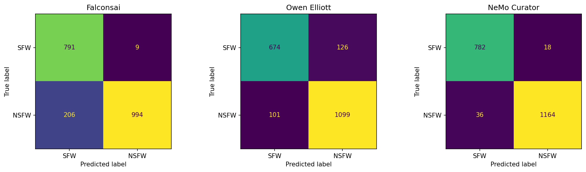
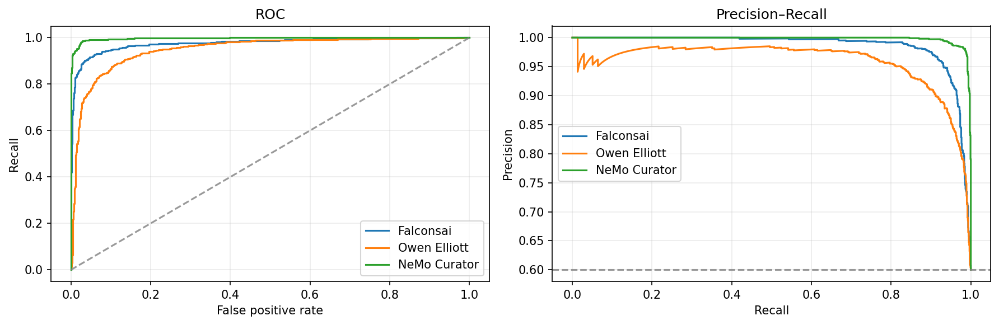
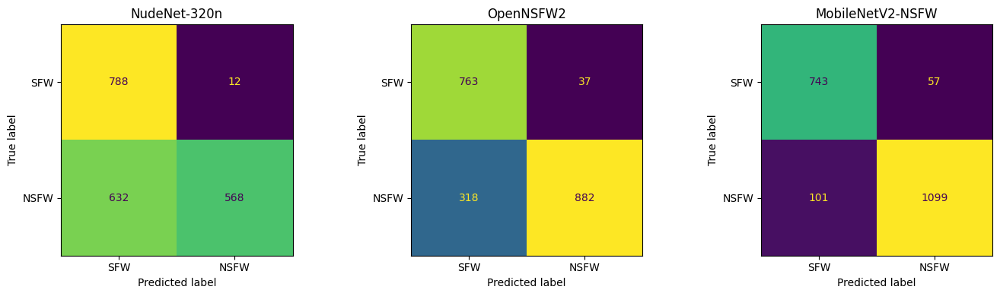
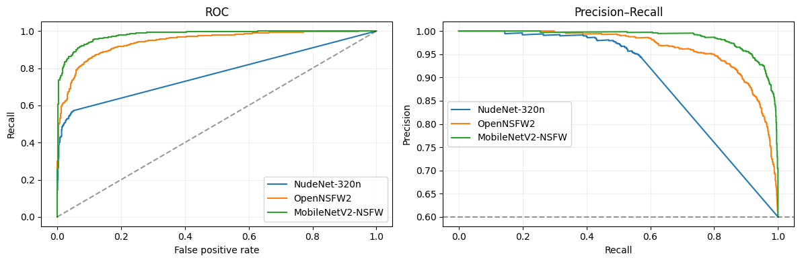

# Image filters: benchmark of NSFW and watermark detectors

First comparison of the detectors for PROJECT.md Part II Step 1b (sensitive images) and Step 1d (watermarks). All
models are pretrained checkpoints, used as they are (no training). The code now lives in `src/filters/`
(`nsfw/`, `watermark/`, `benchmark.py`); the runs below were made with the members' own notebooks and scripts,
which stay on their branches:

| Run | Models | Where | Original code and full outputs |
|---|---|---|---|
| NSFW run A (LMD) | Falconsai, Owen Elliott, NeMo Curator | Kaggle, 1 x T4 | branch `benchmark/nsfw-three-models` (1fdc214), `benchmarks/nsfw/nsfw-image-classification-v2.ipynb`, `Results_LMD.md` |
| NSFW run B (NDM) | NudeNet-320n, OpenNSFW2, MobileNetV2 | Kaggle, 1 x T4 | same branch, `benchmarks/nsfw/Nude.ipynb`, `Results_NDM.md` |
| Watermark (T-024) | YOLOv8n, EfficientNetV2-B0, ConvNeXt-tiny, majority vote | laptop, RTX 4050 | branch `watermark-model` (24f797d), `experiments/T024/` |

To run the models again with the shared code, on these and more community sets (see "Community evaluation sets"):
`notebooks/filters_nsfw_benchmark.ipynb` and `filters_watermark_benchmark.ipynb` (both T4 GPUs; per-image scores
are kept, so every voting method and subset of models gets evaluated).

## NSFW

**Data.** deepghs/nsfw_detect (`nsfw_dataset_v1.zip`), 400 images per class, the same 2,000 images in both runs
(paths sorted, seed 42). Positive (NSFW): `porn`, `hentai`, `sexy` (1,200); negative: `neutral`, `drawings` (800).
Threshold 0.5 for every model.

| Model | Accuracy | Precision | Recall | F1 | ROC-AUC | AP | ms / image | Run |
|---|---:|---:|---:|---:|---:|---:|---:|---|
| NeMo Curator (CLIP ViT-L/14 + NSFW scorer) | **0.973** | 0.985 | **0.970** | **0.977** | **0.997** | **0.998** | 67.1 (batch 64) | A |
| MobileNetV2 (GantMan 1.2.0) | 0.921 | 0.951 | 0.916 | 0.933 | 0.979 | 0.986 | **8.3** (batch 1) | B |
| Owen Elliott (timm) | 0.887 | 0.897 | 0.916 | 0.906 | 0.949 | 0.959 | 12.4 (batch 32) | A |
| Falconsai (ViT) | 0.893 | **0.991** | 0.828 | 0.902 | 0.976 | 0.986 | 15.6 (batch 32) | A |
| OpenNSFW2 (Yahoo) | 0.823 | 0.960 | 0.735 | 0.833 | 0.943 | 0.963 | 195.5 (batch 1) | B |
| NudeNet-320n | 0.678 | 0.979 | 0.473 | 0.638 | 0.770 | 0.822 | 17.3 (batch 1) | B |

Share of images flagged NSFW, per class (for SFW classes lower is better, for NSFW classes higher is better):

| Class | NeMo | MobileNetV2 | Owen | Falconsai | OpenNSFW2 | NudeNet |
|---|---:|---:|---:|---:|---:|---:|
| neutral (SFW) | 0.015 | 0.078 | 0.063 | 0.003 | 0.028 | 0.028 |
| drawings (SFW) | 0.030 | 0.065 | 0.253 | 0.020 | 0.065 | 0.003 |
| sexy (NSFW) | 0.988 | 0.963 | 0.820 | 0.580 | 0.535 | 0.283 |
| hentai (NSFW) | 0.923 | 0.815 | 0.965 | 0.930 | 0.773 | 0.428 |
| porn (NSFW) | 1.000 | 0.970 | 0.963 | 0.975 | 0.898 | 0.710 |

**Findings.**
- NeMo Curator is the most accurate (54 errors of 2,000) but the slowest of the PyTorch models; MobileNetV2 is
  second (F1 0.933) and the fastest.
- `sexy` separates the models most: NudeNet only finds exposed body parts, and Falconsai misses most `sexy`
  images at 0.5 (its F1-optimal threshold is 0.006, which raises its F1 to 0.944, measured on the same images).
- Owen Elliott flags 25% of drawings.
- No vote of several NSFW models was evaluated (the runs kept no per-image scores in the repository).

**Limits.** The label convention (`sexy` and `hentai` are NSFW) favours models trained the same way; NudeNet's
low recall reflects a different definition (exposed parts), not only a weaker model. Speeds come from different
batch sizes and timing setups, so they compare only within a run. No confidence intervals; the set may overlap
the models' training data.

## Watermarks

**Data.** boomb0om/watermarks-validation (pinned revision d2d2270): 122 images, 62 watermark and 60 clean. It is
the evaluation set of the ConvNeXt authors, so it may favour that model. A synthetic set (60 images with text
marks added to 20 clean backgrounds of the same set) was also used; it is not independent and is not ported.
Threshold 0.5; batch 1; FP32.

| Model | Accuracy | Precision | Recall | F1 | FPR | ms / image (p50) | Checkpoint |
|---|---:|---:|---:|---:|---:|---:|---:|
| ConvNeXt-tiny (boomb0om) | **0.934** | **0.982** | **0.887** | **0.932** | **0.017** | **15.5** | 113 MB |
| Majority vote of the three | 0.705 | 0.933 | 0.452 | 0.609 | 0.033 | 77.5 (sum) | 144 MB |
| EfficientNetV2-B0 (qwertyforce) | 0.607 | 0.769 | 0.323 | 0.455 | 0.100 | 26.7 | 24 MB |
| YOLOv8n (qfisch) | 0.582 | 0.824 | 0.226 | 0.354 | 0.050 | 34.7 | 6 MB |

On the synthetic set the order is the same (ConvNeXt F1 0.677, the others 0.14-0.22).

**Findings.** ConvNeXt-tiny is the best and the fastest model. The majority vote is far worse than ConvNeXt
alone (F1 -0.32) and costs about five times the time: the two weak models outvote it.

**Limits.** 122 images, possibly seen by the ConvNeXt authors; EfficientNet's fine-tuning transform is unknown
(the 192 px centre crop from its checkpoint may cut marks near the edges); laptop GPU, not Kaggle.

## Detectors and where they come from

Besides the members' models, the code now has the baselines that PROJECT.md plans. None of these tasks has a
widely used academic benchmark that we know of, and both evaluation sets above are community sets, so this report
says so plainly and adds the detectors that have a paper behind them.

| Task | Detector (`--model`) | Origin | Measured |
|---|---|---|---|
| NSFW | `opennsfw2` | Yahoo Open-NSFW (2016 release, no paper); **the filter of RealEdit (CVPR 2025)**, our main reference | run B |
| NSFW | `nemo` | **LAION's CLIP-based NSFW detector** (an MLP on CLIP ViT-L/14 embeddings), used to filter LAION-5B (NeurIPS 2022), run through NVIDIA NeMo Curator | run A |
| NSFW | `clip` | **CLIP zero-shot** (ICML 2021): NSFW prompts against safe prompts, same ViT-L/14 encoder as `nemo` | not yet |
| NSFW | `falconsai`, `owen`, `mobilenet`, `nudenet` | community checkpoints (Hugging Face, GitHub) | runs A and B |
| Watermark | `laion` | **LAION's watermark classifier** (EfficientNet-B3a), used to filter LAION-5B, MIT licence | not yet |
| Watermark | `clip` | **CLIP zero-shot**: watermarked against clean prompts | not yet |
| Watermark | `ocr` | **OCR text detection**: EasyOCR with the CRAFT detector (CVPR 2019); flags any text, a lower bound | not yet |
| Watermark | `convnext`, `efficientnet`, `yolo` | community checkpoints | T-024 |

## Against the plan (PROJECT.md Step 1b and 1d)

Hand labels of our own images were dropped from the plan on 2026-11-06 (time): models, votes and thresholds are
chosen on the public sets, and on our data only the share of flagged images is reported.

| Plan item | NSFW | Watermark |
|---|---|---|
| Several detectors, including the planned baselines | done in code: 7 (opennsfw2, NudeNet, ViT, CLIP zero-shot as planned) | done in code: 6 (LAION, OCR, CLIP zero-shot as planned) |
| Measured on a benchmark | 6 of 7 (not `clip`) | 3 of 6 (not `laion`, `clip`, `ocr`) |
| Single models against votes of every subset (mean, weighted, any, majority) | code ready, not run | code ready, not run (only the majority of all 3 was run) |
| Run on every original and edit of the dataset | not run | not run |
| Drop flagged edits and their pairs; the sample if the original is flagged or fewer than 2 edits remain | code ready (`python -m src.rank export`) | same |

## Community evaluation sets (added 2026-11-06)

Verified on the Hugging Face Hub and pinned to a commit (`src/filters/benchmark.py`); at most 1,000 images per class.

| Task | Set | Source | Images | Note |
|---|---|---|---|---|
| NSFW | `deepghs` | deepghs/nsfw_detect | 2,000 (5 classes) | the first benchmark's sample; GantMan-style classes, so MobileNetV2 may have seen similar data |
| NSFW | `nsfw_xl` | markandey14/nsfw_detection_xl (MIT) | 2,000 | sources not stated; the nsfw side includes drawn and anime images |
| NSFW | `unsafebench` | yiting/UnsafeBench (gated) | up to 2,000 | real LAION-5B images only, Sexual vs safe; LAION's NSFW tags came from the `nemo` head, so `nemo` may be favoured |
| Watermark | `boomb0om` | boomb0om/watermarks-validation | 122 | the ConvNeXt authors' evaluation set |
| Watermark | `scenery` | qwertyforce/scenery_watermarks (CC BY-NC 4.0) | 2,000 | real photographers' marks on r/EarthPorn photos; the training set of `efficientnet` (not a fair test for it) |
| Watermark | `wm_or_not` | prithivMLmods/Watermark-or-Not-20K (Apache-2.0) | 2,000 | synthetic text marks, some very faint |

Rejected: sets that are the training data of a checkpoint we test (e.g. bastienp/visible-watermark-pita for
`yolo`), sets with one class only, AI-generated sets, and sets needing the owner's manual approval.

## Next runs (on Kaggle, after approval)

1. `notebooks/filters_nsfw_benchmark.ipynb` and `filters_watermark_benchmark.ipynb`, first with `SMOKE = True`
   (20 images per model: every model loads and runs), then in full (NSFW about 1-1.5 h, watermark 30-60 min on
   2 x T4). Output: `evaluation.md` with accuracy, precision, recall, F1, ROC-AUC per model and per set, latency of
   one image (p50, p95) and throughput, and the best votes over subsets of models.
2. Choose the model or vote per task from these tables, set `CHOICE` in `notebooks/filters_apply.ipynb`, run it on
   the 56,568 dataset images (both GPUs share every model), download `filter_decisions.zip`.
3. On the coordinator's computer: put the decisions into `work/filters/<task>/`, run `python -m src.rank export`
   (drops flagged edits and samples, reports the counts for the data-loss funnel), then
   `python -m src.process pack` and upload the new Kaggle dataset.
