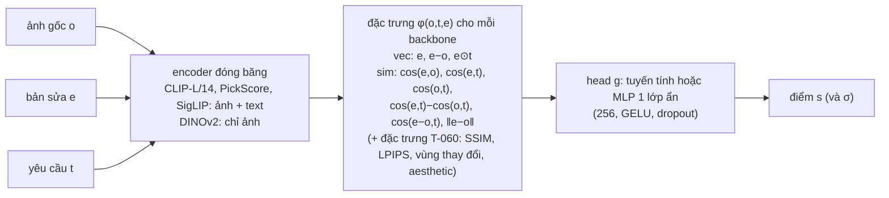

# T-025: Khảo sát và đề xuất kiến trúc cho model scorer

Người thực hiện: NT.Trung, PT.Dung. Branch: `scorer/trung`. Phụ thuộc: T-022 (nhãn ranking v1).

**Tóm tắt.** Bộ chấm nhận (ảnh gốc *o*, yêu cầu *t*, bản sửa *e*) và trả về điểm *s(o, t, e)*. Khi train, model chỉ
nhìn các cặp bản sửa của cùng một yêu cầu với nhãn "A tốt hơn B". Khi inference, mỗi bản sửa được chấm riêng
và bản có điểm cao nhất thắng. Cách này giống HPSv3 và EditReward. Hai model đó fine-tune toàn bộ một VLM 7B trên
200 nghìn đến hơn 1 triệu cặp. Dữ liệu v1 của nhóm chỉ có **10.598 cặp train**, nhãn nhiễu (Krippendorff's α =
0,14), và nhóm chạy trên GPU T4 của Kaggle. Vì vậy đề xuất chính là:

> **Encoder đóng băng + head nhỏ học theo cặp.** CLIP/SigLIP (ảnh và yêu cầu) và DINOv2 (giữ nguyên ảnh) tính
> embedding một lần. Một head tuyến tính hoặc MLP trên các đặc trưng (*e*, *e − o*, *e ⊙ t*, các cosine) cho ra điểm.
> Head được train với loss Bradley-Terry trên **nhãn mềm `p_a`** của bước finalize, hoặc với loss có độ bất định
> theo HPSv3.

VLM reward model (EditReward, EditScore) là hướng mở rộng nếu có GPU từ 24 GB trở lên. VLM-as-judge (T-062) là
baseline để so sánh. Bản chạy thử đã có trong code (`src/scorer`, `notebooks/scorer_pilot.ipynb`). Kết quả sẽ
được điền vào mục 6 sau khi chạy trên Kaggle.

---

## 1. Bài toán và ràng buộc

| | Dữ liệu nhóm (v1, finalize 2026-10-13) |
|---|---|
| Đơn vị | 1 sample = 1 yêu cầu + 1 ảnh gốc + 2 đến 14 bản sửa của cộng đồng |
| Nhãn | thứ hạng cuối cùng của mỗi sample, gộp 3 người rank và thứ tự upvote (RealEdit); `pairs.jsonl` có `p_a` = P(A tốt hơn B) và `winner` |
| Quy mô | 6.996 sample đã rank, 15.287 cặp: train 10.598, dev 2.239, test 2.450 (chia theo sample, cố định bằng hash) |
| Nguồn | RealEdit 5.749, GIER 1.229, khác 18. VOZ bị loại khỏi train (`trainable: false`) |
| Độ nhiễu | Hai người đồng ý trên 57,8% cặp. Độ chính xác ước lượng của từng người là 0,57–0,73 |
| Thiên lệch | App hiện edit 01 (upvote cao nhất) trước. Ở GIER, nơi số thứ tự không mang ý nghĩa, người rank vẫn xếp 01 đầu tiên ở 56% số lần, so với 44% nếu ngẫu nhiên |
| Phần cứng | Kaggle: 2 × T4 16 GB (không có bf16 nhanh), phiên tối đa 12 giờ |

Ràng buộc thiết kế:

1. **Chấm được ảnh do AI sửa.** T-071 và T-075 dùng scorer để chọn kết quả của các model edit, nên đầu vào chỉ
   gồm (*o*, *t*, *e*). Không dùng upvote, thứ tự edit, tác giả hay comment (giống quy tắc của `src/features`).
2. **Train theo cặp, inference theo điểm.** Điểm chỉ cần so sánh được giữa các bản sửa của cùng một yêu cầu,
   không cần hiệu chỉnh giữa các yêu cầu khác nhau.
3. **Mục tiêu dự án (3):** pairwise accuracy trên tập test vượt baseline CLIP-score.
4. **Nhẹ.** Phải train được trong vài giờ T4 và chạy được trong demo (T-079), có thể chỉ có CPU.

## 2. Khảo sát

### 2.1. Reward model cho ảnh sinh từ văn bản (text-to-image)

| Công trình | Backbone | Dữ liệu preference | Loss / đầu ra | Ghi chú cho nhóm |
|---|---|---|---|---|
| ImageReward (Xu et al., NeurIPS 2023) | BLIP + MLP | 137 nghìn cặp so sánh của chuyên gia | ranking loss theo cặp, ra 1 điểm | Train theo cặp, inference ra điểm: đúng khuôn của nhóm |
| PickScore (Kirstain et al., NeurIPS 2023) | CLIP-H fine-tune | Pick-a-Pic, hơn 500 nghìn lượt chọn của người dùng | softmax trên 2 ảnh (kiểu InstructGPT), có xử lý hòa | Đã có trọng số; dùng làm backbone `pickscore` |
| HPSv2 (Wu et al., 2023) | CLIP-H fine-tune | HPD v2, khoảng 798 nghìn lượt chọn | như PickScore | |
| **HPSv3** (Ma et al., ICCV 2025) | VLM Qwen2-VL 7B + MLP head trên hidden state | HPDv3: 1,08 triệu cặp text-ảnh, 1,17 triệu so sánh | **uncertainty-aware ranking loss**: mỗi ảnh có điểm Gauss N(μ, σ²) | Đạt accuracy 76,9% trên HPDv3 test. Ý tưởng loss có độ bất định được dùng trong pilot |

Cả nhóm này đều chấm **(prompt, ảnh)**, không nhìn ảnh gốc. Vì vậy chúng không biết bản sửa có giữ đúng
những phần không được yêu cầu sửa hay không. Đó là tiêu chí thứ hai trong guideline của nhóm (T-008).

### 2.2. Chấm ảnh đã sửa theo yêu cầu (instruction-guided editing)

| Công trình | Cách chấm | Ghi chú |
|---|---|---|
| CLIP-T, CLIP-I, CLIP directional, DINO, L1 (InstructPix2Pix, MagicBrush) | Cosine giữa embedding: bản sửa với yêu cầu, bản sửa với ảnh gốc, (bản sửa − gốc) với yêu cầu | Baseline zero-shot rẻ nhất. **CLIP-score là mốc phải vượt** |
| VIEScore (Ku et al., ACL 2024) | GPT-4V/VLM cho điểm mức độ làm đúng yêu cầu (SC) và chất lượng cảm nhận (PQ) | VLM-as-judge, không cần train. Gần với T-062 |
| ADIEE (ICCV 2025) | Tự động tạo dữ liệu, train một scorer cho chấm edit | Kém EditReward trên GenAI-Bench và AURORA (bảng của EditReward) |
| **EditReward** (Wu et al., ICLR 2026) | Qwen2.5-VL-7B hoặc MiMo-VL-7B. Đầu vào: (ảnh gốc, yêu cầu, bản sửa). MLP head cho 2 chiều (làm đúng yêu cầu, chất lượng ảnh), mỗi chiều có (μ, σ). Uncertainty-aware ranking loss theo HPSv3 | Hơn 200 nghìn cặp do chuyên gia gắn nhãn, ảnh sửa bởi các model AI. Full fine-tune trên 8 × A800, lr 2e-6, 2 epoch. Accuracy 65,7% trên GenAI-Bench, 63,6% trên AURORA-Bench, cao hơn GPT-5 (59,6% và 47,3%). Trọng số: `TIGER-Lab/EditReward-Qwen2.5-VL-7B`, `TIGER-Lab/EditReward-MiMo-VL-7B-SFT-2508` |
| **EditScore** (2025) | Qwen2.5-VL (7B đến 72B) fine-tune LoRA theo kiểu sinh văn bản: model viết lập luận rồi cho điểm | Dùng làm reward cho RL của OmniGen2. Bản lớn nhất vượt GPT-5 trên benchmark của họ. Trọng số `EditScore/EditScore-7B` (LoRA) |

Nhận xét. Các model mạnh nhất cho bài toán này đều là **VLM 7B fine-tune trên 100 nghìn đến 1 triệu cặp**. Nhưng
ngay cả chúng cũng chỉ đạt khoảng 60–66% accuracy theo cặp trên các benchmark edit. Đây là bài toán khó và nhãn
của người vốn đã nhiễu. Nhãn của nhóm còn nhiễu hơn (α 0,14 so với 0,6–0,67 ở EditReward-Data), nên trần
accuracy thực tế cũng thấp hơn. Pilot ước lượng trần này (mục 4.4).

### 2.3. Loss cho dữ liệu xếp hạng

- **Bradley-Terry / RankNet:** P(A > B) = sigmoid(s_A − s_B). Đây là logistic regression trên hiệu đặc trưng nếu
  head là tuyến tính (đúng kế hoạch T-061).
- **Nhãn mềm:** thay nhãn 0/1 bằng `p_a` của finalize. Một cặp mà 3 người chia 2-1 sẽ kéo model ít hơn một cặp
  cả 3 người đồng ý. Dữ liệu của nhóm có sẵn `p_a`, nên dùng được ngay mà không tốn thêm gì.
- **Uncertainty-aware (HPSv3, EditReward):** s ~ N(μ, σ²), P(A > B) = Φ((μ_A − μ_B) / √(σ_A² + σ_B²)). Model tự
  học được bản sửa nào khó chấm.
- **Listwise (Plackett-Luce, ListNet):** dùng cả thứ hạng 2–6 bản sửa một lúc. Với dữ liệu hiện có, các cặp kèm
  `p_a` đã chứa gần hết thông tin này. Để dành nếu còn thời gian.

## 3. Phân tích: điều gì quan trọng với dữ liệu của nhóm

1. **Ít dữ liệu so với tài liệu** (10,6 nghìn cặp, so với 200 nghìn ở EditReward và 1,17 triệu ở HPSv3).
   Fine-tune toàn bộ một VLM 7B dễ overfit và cũng không vừa T4. Một head nhỏ trên encoder đóng băng chỉ có vài
   trăm nghìn tham số, hợp với quy mô này.
2. **Nhãn nhiễu.** Cần dùng nhãn mềm, đánh giá thêm trên các cặp "chắc chắn" (`p_a` ≥ 0,8 hoặc ≤ 0,2), và luôn
   báo cáo kèm trần của người (một người rank đồng ý với hai người còn lại bao nhiêu phần trăm).
3. **Thiên lệch vị trí và upvote.** Baseline "edit-key-order" (01 thắng) đo xem nhãn lệch theo thứ tự đến đâu.
   Scorer không được biết số thứ tự. Kết quả cũng được báo cáo riêng theo nguồn: ở GIER, thứ tự 01 không mang ý
   nghĩa.
4. **Chênh lệch miền dữ liệu.** Lúc train là ảnh thật do cộng đồng sửa bằng Photoshop (xóa vật, phục chế, đổi
   nền, chế ảnh). Lúc dùng (T-071, T-075) là ảnh do AI sửa. Encoder tổng quát đóng băng ít bị khớp vào kiểu ảnh
   của một miền hơn so với fine-tune toàn bộ model.
5. **Yêu cầu dài.** Một bài trên Reddit hay forum có thể dài nhiều câu, trong khi CLIP chỉ đọc 77 token và
   SigLIP 64 token (pilot cắt bớt, thường giữ được tiêu đề). Khi `src/instructions` chạy xong trên toàn bộ dữ
   liệu, nên thay bằng **chỉ dẫn đã rút gọn** (simplified instruction) làm *t*. Bản rút gọn chỉ dùng làm đầu vào,
   không bao giờ dùng làm nhãn.

## 4. Kiến trúc đề xuất

### 4.1. Model chính: encoder đóng băng + head chấm điểm (đã cài trong `src/scorer`)



- **Train (siamese):** hai bản sửa A, B của cùng một sample đi qua cùng một head, sau đó tính
  P(A > B) = sigmoid(s_A − s_B) (loss `bt`/`soft`) hoặc Φ(Δμ / √(σ_A² + σ_B²)) (loss `uncertainty`). Loss là
  cross-entropy với `winner` hoặc `p_a`. Chọn epoch tốt nhất theo accuracy trên dev (early stopping). Test chỉ
  báo cáo một lần.
- **Inference:** mỗi bản sửa qua encoder một lần, rồi qua head để ra một điểm. Bản có điểm cao nhất là bản tốt
  nhất. Embedding ảnh gốc và yêu cầu được dùng lại cho mọi ứng viên của cùng yêu cầu (đúng nhu cầu cache của
  T-072).
- **Vì sao chọn hướng này:**
  - Rẻ: embed toàn bộ dữ liệu khoảng 1 giờ T4, train vài phút trên CPU.
  - Hợp quy mô dữ liệu.
  - Dễ giải thích: head tuyến tính trên đặc trưng `sim` cho ra trọng số của từng tiêu chí, như "giống ảnh gốc"
    hay "khớp yêu cầu", dùng được cho báo cáo và feature importance của T-061.
  - Dễ mở rộng: các đặc trưng của T-060 chỉ cần nối thêm vào φ.
- **Vai trò của từng phần:**
  - **e ⊙ t** và các cosine với *t*: bản sửa có làm đúng yêu cầu không.
  - **e − o**, cos(e, o) và DINOv2: bản sửa có giữ những gì không được yêu cầu đổi không. DINOv2 nhạy với cấu
    trúc và danh tính hơn CLIP.
  - **e**: chất lượng và thẩm mỹ của chính ảnh. PickScore đã được fine-tune theo sở thích của người.

### 4.2. Mở rộng: VLM reward model (khi có GPU từ 24 GB)

Nếu head nhỏ chưa vượt rõ CLIP-score, bước tiếp theo là kiến trúc của EditReward. Đầu vào (*o*, *e*, *t*) đi
vào Qwen2.5-VL. Hidden state của token cuối đi qua MLP để ra (μ, σ), train bằng uncertainty loss. Có hai cách:

- **Zero-shot** với `TIGER-Lab/EditReward-Qwen2.5-VL-7B` trên tập test của nhóm. Đây là phép thử rẻ nhất xem
  reward model của ảnh AI có chuyển được sang ảnh do cộng đồng sửa không. Code của họ cần bf16 và khoảng 16 GB
  cho một GPU (load bằng `model.to(device)`), ghim `transformers==4.57.0` và nên có flash-attn. Vì vậy **không
  chạy được trên một T4** nếu không sửa code để lượng tử hóa hoặc chia model ra 2 GPU.
- **Fine-tune LoRA** từ Qwen2.5-VL-3B (khoảng 7,5 GB ở fp16, vừa một T4) hoặc từ trọng số EditReward, trên
  10,6 nghìn cặp của nhóm. Dự kiến vài giờ mỗi epoch trên T4 và có nguy cơ overfit. Chỉ nên làm sau khi có nhãn
  v2 (thêm khoảng 10 nghìn sample).

### 4.3. Baseline để so sánh (bảng kết quả của pilot)

| Baseline | Ý nghĩa |
|---|---|
| ngẫu nhiên | 50% theo cặp. Top-1 = trung bình 1/(số bản sửa) |
| `edit-key-order` | 01 thắng, tức thứ tự upvote và thứ tự hiển thị trên app. **Đo thiên lệch của nhãn**, không phải một scorer hợp lệ |
| `image-pixels`, `file-bytes` | Ảnh to hơn hoặc nhiều chi tiết hơn thì thắng? (kiểm tra yếu tố gây nhiễu) |
| `<backbone>:edit-request` | **CLIP-score** (mốc của mục tiêu dự án), cùng các bản PickScore và SigLIP |
| `<backbone>:edit-original` | Giống ảnh gốc nhất thì thắng (giữ nguyên ảnh) |
| `<backbone>:direction` | cos(e − o, t): thay đổi đi đúng hướng yêu cầu |
| VLM-as-judge (T-062) | Qwen2.5-VL chọn A hay B, chạy sau |

### 4.4. Cách đánh giá (`src/scorer/evaluate.py`)

- **Pairwise accuracy** trên dev và test (hai điểm bằng nhau tính 1/2), kèm **khoảng tin cậy 95% bằng bootstrap
  theo sample**, vì các cặp của cùng một sample không độc lập.
- **Weighted accuracy** (trọng số |2p_a − 1|) và **confident accuracy** (chỉ các cặp `p_a` ≥ 0,8 hoặc ≤ 0,2).
- **Top-1:** bản có điểm cao nhất có phải là best edit cuối cùng không, so với mức ngẫu nhiên.
- **Theo nguồn:** RealEdit và GIER.
- **Trần của người:** một người rank đồng ý với hai người còn lại (khi hai người đó đồng ý với nhau) trên bao
  nhiêu phần trăm cặp. Một scorer đạt gần mức này là đã gần hết mức dữ liệu cho phép.

## 5. Pilot: cách chạy

Code: `src/scorer/` (`backbones/`, `embed.py`, `heads.py`, `train.py`, `evaluate.py`), cấu hình
`configs/scorer.toml`, test `tests/test_scorer.py` (dữ liệu tổng hợp). Notebook: `notebooks/scorer_pilot.ipynb`.

```bash
python -m src.scorer embed --backbone clip-l14     # trên Kaggle: cache embedding (một lần cho mỗi backbone)
python -m src.scorer baselines                     # baseline zero-shot + trần của người
python -m src.scorer train                         # mọi run trong configs/scorer.toml (CPU là đủ)
python -m src.scorer report                        # data/scorer/report.md
```

Các run trong config là các ablation:

1. `linear-sim-all`: head tuyến tính trên các cosine của cả 4 backbone. Đây là logistic Bradley-Terry của T-061,
   dễ giải thích nhất.
2. `mlp-clip-soft` và `mlp-clip-bt`: nhãn mềm so với nhãn cứng.
3. `mlp-pickscore-soft`, `mlp-siglip-soft`, `mlp-siglip-dino-soft`: so sánh các backbone.
4. `mlp-all-soft` và `mlp-all-uncertainty`: loss Bradley-Terry so với loss có độ bất định của HPSv3.

## 6. Kết quả pilot

*Chờ chạy `notebooks/scorer_pilot.ipynb` (STEP = `full`) trên Kaggle. Dán bảng `report.md` vào đây, cùng thời gian
mỗi ảnh lấy từ `embeddings/*/meta.json`.*

## 7. Kết nối với các task sau

- **T-060 (đặc trưng):** các đặc trưng tay (SSIM, LPIPS, changed-area, aesthetic, độ khớp với mô tả VLM) ghi vào
  `data/features/<feature>.jsonl` theo `image_id`. Chỉ cần nối thêm vào φ trong `train.edit_features` là dùng được.
- **T-061 (train và đánh giá):** dùng luôn framework này (config, split, metric, report). Thêm LightGBM pairwise
  nếu muốn so với head tuyến tính hoặc MLP.
- **T-062 (VLM-as-judge):** ghi điểm hoặc lựa chọn theo `image_id`, rồi đánh giá bằng
  `evaluate.evaluate_scores` trên cùng các cặp test.
- **T-072 (module inference):** `head.pt` chứa trọng số, mean và std của đặc trưng, và config. Hàm
  `score(original, edit, request)` gồm: encode bằng các backbone trong config, dựng φ, rồi gọi head.

## 8. Rủi ro và hạn chế

- Nhãn lệch theo thứ tự hiển thị và theo upvote. Có thể scorer học được "giống edit được upvote", không phải
  "edit tốt". Cần đối chiếu kết quả trên GIER, và **xáo thứ tự bản sửa khi rank v2** (README đã ghi).
- Processor của CLIP và DINOv2 cắt ảnh ở giữa (center crop), nên thay đổi ở mép ảnh (mở rộng khung, cắt ảnh)
  có thể bị bỏ sót. Có thể thử resize giữ nguyên toàn khung (padding) sau.
- Yêu cầu dài bị cắt ngắn (mục 3.5).
- Nhãn v1 thiếu các sample có người bỏ qua (625 sample). Nếu đó chủ yếu là các ca khó thì tập test sẽ dễ hơn
  thực tế.
- Điểm không hiệu chỉnh giữa các yêu cầu khác nhau. Router (T-075) chỉ được so điểm trong cùng một yêu cầu.

## Tài liệu tham khảo

- HPSv3: Ma et al., *HPSv3: Towards Wide-Spectrum Human Preference Score*, ICCV 2025. https://arxiv.org/abs/2508.03789,
  code https://github.com/MizzenAI/HPSv3
- HPSv2: Wu et al., *Human Preference Score v2*, 2023. https://arxiv.org/abs/2306.09341
- ImageReward: Xu et al., NeurIPS 2023. https://arxiv.org/abs/2304.05977
- PickScore / Pick-a-Pic: Kirstain et al., NeurIPS 2023. https://arxiv.org/abs/2305.01569
- EditReward: Wu et al., *EditReward: A Human-Aligned Reward Model for Instruction-Guided Image Editing*, ICLR 2026.
  https://arxiv.org/abs/2509.26346, code https://github.com/TIGER-AI-Lab/EditReward
- EditScore: *EditScore: Unlocking Online RL for Image Editing via High-Fidelity Reward Modeling*, 2025.
  https://arxiv.org/abs/2509.23909, model https://huggingface.co/EditScore/EditScore-7B
- VIEScore: Ku et al., ACL 2024. https://arxiv.org/abs/2312.14867
- InstructPix2Pix (Brooks et al., CVPR 2023), MagicBrush (Zhang et al., NeurIPS 2023): các độ đo CLIP-I, CLIP-T,
  DINO, CLIP directional.
- RealEdit (Sushko et al., CVPR 2025), GIER (Shi et al., ACCV 2020): nguồn dữ liệu của nhóm.
- CLIP (Radford et al., 2021), SigLIP (Zhai et al., ICCV 2023), DINOv2 (Oquab et al., 2023).
- Bradley & Terry (1952); RankNet: Burges et al., ICML 2005.
